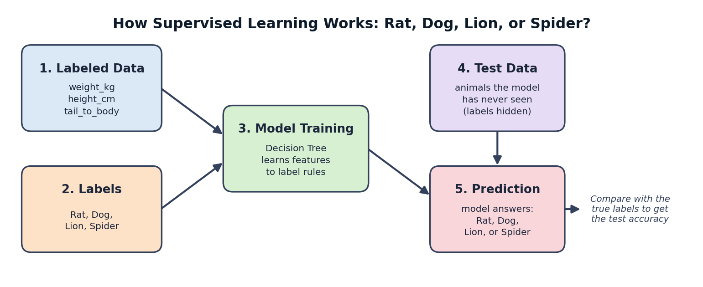
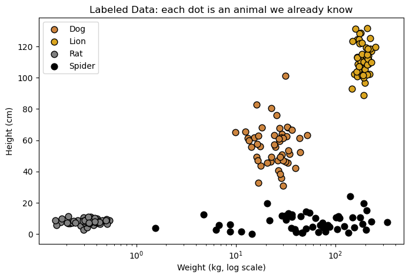
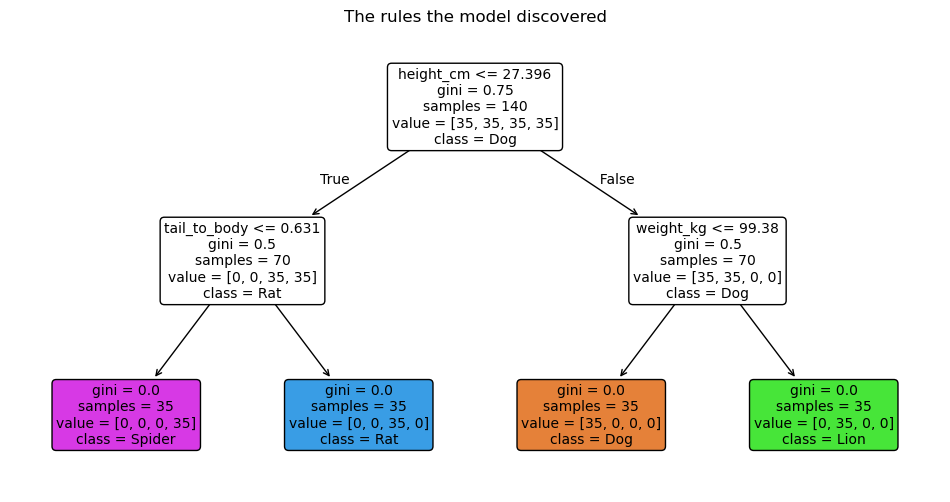
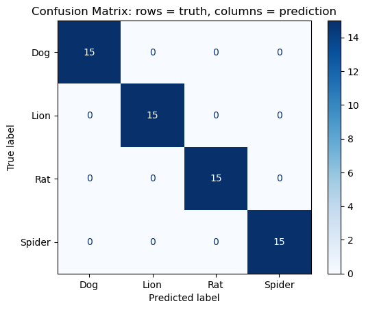

# Supervised Learning: Rat, Dog, or Lion?

**Author:** David Bahidika
**Course:** CAP 4620 Artificial Intelligence, Florida A&M University
**Date:** October 10, 2026
**Environment:** NRP JupyterHub, Python 3 (ipykernel)

## Project Description
This project shows how supervised learning works. A model is trained on
animals whose answers (labels) we already know, and then it predicts the
label of animals it has never seen.



## Project Structure
```
Lab1_SupervisedL/
├── data/      # generated datasets and predictions (CSV)
├── figures/   # plots exported from the notebook (PNG)
├── models/    # trained model (.joblib) and model card (.json)
├── README.md
└── SupervisedL.ipynb
```

## Data
The dataset is **synthetic**: it is generated with NumPy (`np.random.seed(42)`),
with 50 examples per animal class.

| Feature | Meaning |
|---|---|
| `weight_kg` | body weight in kilograms |
| `height_cm` | shoulder height in centimeters |
| `tail_to_body` | tail length divided by body length |

**Label:** `animal` (Dog, Lion, Rat, Spider)

| File | Description |
|---|---|
| `data/animals_full.csv` | all generated animals (features + label) |
| `data/train.csv` | training split (70%) |
| `data/test.csv` | test split (30%), hidden during training |
| `data/predictions.csv` | test animals with true vs. predicted label |

## Method
1. Separate features (`X`) from labels (`y`).
2. Split into training (70%) and test (30%) data with `stratify=y`.
3. Train a `DecisionTreeClassifier` (`max_depth = 3`, `random_state = 42`).
4. Predict the test data and evaluate with accuracy, a classification report
   and a confusion matrix.

## Model
| File | Description |
|---|---|
| `models/decision_tree.joblib` | the trained Decision Tree |
| `models/model_info.json` | model settings and test accuracy |

Load it with:
```python
import joblib
model = joblib.load("models/decision_tree.joblib")
```

## Results
**Test accuracy:** 100% (all 60 test animals classified correctly)


*Each dot is an animal. The classes sit in different regions of the plot.*


*The yes/no rule(s) the model learned. First split feature: `height_cm` (height_cm <= 27.4).*


*Rows = true animal, columns = predicted animal. Most confused classes: none. Every test animal landed on the diagonal.*

## Discussion
1. **Why do we need labels?** Labels are the correct answers. Without them the model has nothing to check its guesses against, so it cannot learn which mix of weight, height and tail ratio belongs to which animal.
2. **What would the model predict for a cat, and why is that a problem?** A cat is not one of the 4 classes, so the model is still forced to answer Rat, Dog, Lion or Spider. A cat is shorter than 27.4 cm and has a long tail, so it would most likely be called a Rat. The problem is that a supervised model can only predict labels it was trained on, and it gives a wrong answer with no warning that the animal is something new.
3. **Which feature did the tree use first, and why?** `height_cm` (height_cm <= 27.4). One height question splits the small animals (Rat, Spider) from the big ones (Dog, Lion), which separates the classes better than any other single question.
4. **How does `max_depth` affect accuracy?** With max_depth = 1 the accuracy was 50%, because one question can only split the data into 2 groups, so at most 2 of the 4 animals can be told apart. With max_depth = 2 the accuracy jumped to 100%, and max_depth = 3 also gave 100%. Two questions are enough for this dataset, so going deeper added nothing.

## How to Run
1. Open the project on the NRP JupyterHub.
2. Open `SupervisedL.ipynb` and choose **Run → Run All Cells**.
3. The final cells save the data to `data/` and the model to `models/`.

## Requirements
`numpy`, `pandas`, `matplotlib`, `scikit-learn`, `joblib`